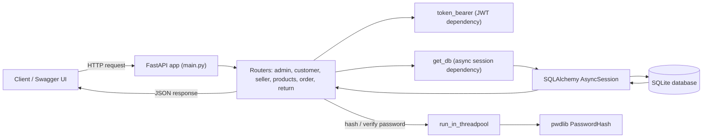

# E-Commerce API

A role-based e-commerce backend built with FastAPI and async SQLAlchemy.

Customers browse products and place orders, sellers manage their catalog and fulfil orders, and admins oversee the whole marketplace. Every protected route is secured with JWT authentication.

---

## What It Does

- **Three user roles** — customer, seller, and admin, each with their own registration/login flow and permissions
- **Product catalog** — sellers add products, edit details, adjust stock, and change prices
- **Ordering** — customers place orders; stock is reduced automatically and the price at purchase time is stored on the order
- **Order lifecycle** — `packing` → `shipping` → `delivered`, or `cancelled` by the customer, the seller, or an admin
- **Returns** — customers request a return for an order; sellers move it through the return workflow
- **Admin tools** — view all sellers and products, delete users or products, and create additional admins
- **Auth** — JWT tokens with password hashing via pwdlib, plus role checks on protected routes
- **Test suite** — pytest tests running against a separate SQLite test database

---

## Tech Stack

| Layer      | Tech                                                      |
| ---------- | --------------------------------------------------------- |
| Framework  | FastAPI                                                   |
| Database   | SQLite (async via aiosqlite)                              |
| ORM        | SQLAlchemy 2.0 async (`Mapped` / `mapped_column` style)   |
| Validation | Pydantic                                                  |
| Auth       | PyJWT + pwdlib (`PasswordHash.recommended()`)             |
| Config     | pydantic-settings                                         |
| IDs        | UUIDv7 (`uuid.uuid7`)                                     |
| Testing    | pytest + pytest-asyncio + FastAPI `TestClient`            |
| Tooling    | uv (`pyproject.toml` + `uv.lock`)                         |

> **Note:** The code uses `uuid.uuid7`, which is part of the Python standard library from **Python 3.14** onward.

---

## Roles & Permissions

| Role         | What they can do                                                                                                                                                         |
| ------------ | ------------------------------------------------------------------------------------------------------------------------------------------------------------------------ |
| **Customer** | Register, log in, view profile, change password, browse products, place orders, check order status, cancel their own orders, request returns, view their own orders and returns |
| **Seller**   | Register, log in, view profile, change password, add and modify products, change price and stock, view their own products and orders, update order and return status, cancel orders |
| **Admin**    | Log in, create other admins, view all sellers and products, delete users and products, cancel any order                                                                  |

Login routes use the standard OAuth2 password form — enter your **email** in the `username` field.

Token lifetimes: **customer 20 min**, **seller 20 min**, **admin 60 min**.

---

## API Endpoints

Routes marked *(protected)* need an `Authorization: Bearer <access_token>` header.

### Admin (`/admin`)

```
POST /admin/registration                 — create a new admin (protected, admin only)
POST /admin/admin_login                  — returns JWT token
GET  /admin/get_sellers?limit=&skip=     — list sellers, paginated (protected, admin only)
GET  /admin/get_seller/{seller_id}       — get one seller (protected, admin only)
GET  /admin/get_products?limit=&skip=    — list products, paginated (protected, admin only)
GET  /admin/get_products/{product_id}    — get one product (protected, admin only)
GET  /admin/delete_user/{id}             — delete a user (protected, admin only)
GET  /admin/delete_product/{id}          — delete a product (protected, admin only)
```

Pagination defaults for `get_sellers` and `get_products`: `limit=10, skip=0`.

### Customer (`/customer`)

```
POST /customer/create_customer     — register a customer account
POST /customer/customer_login      — returns JWT token
GET  /customer/details             — current customer's profile (protected)
PUT  /customer/change_password     — change password, needs old password (protected)
GET  /customer/get_orders          — all of your orders (protected, customer only)
```

### Seller (`/seller`)

```
POST /seller/create_seller         — register a seller account (store name must be unique)
POST /seller/seller_login          — returns JWT token
GET  /seller/details               — current seller's profile (protected, seller only)
GET  /seller/get_products          — products you have listed (protected, seller only)
PUT  /seller/change_password       — change password, needs old password (protected, seller only)
GET  /seller/get_orders            — orders placed for your products (protected, seller only)
```

### Products (`/products`)

```
POST /products/add_products                                  — add a product (protected, seller only)
PUT  /products/modify_products/{product_id}                  — update name/description (protected, owning seller only)
GET  /products/list_products?limit=&skip=                    — list all products, paginated (protected)
GET  /products/list_products_by_seller/{seller_id}?limit=&skip=  — list one seller's products, paginated (public)
PUT  /products/increase_stock/{product_id}?quantity=         — add stock, quantity > 0 (protected)
PUT  /products/decrease_stock/{product_id}?quantity=         — remove stock, quantity > 0 (protected, seller only)
PUT  /products/change_price/{product_id}?new_price=          — set a new price, must be >= 0 (protected, seller only)
```

Pagination defaults: `list_products` uses `limit=1000, skip=0`; `list_products_by_seller` uses `limit=10, skip=0`.

### Orders (`/order`)

```
POST /order/place_order/{product_id}                  — place an order for one unit (protected, customer)
PUT  /order/change_status/{order_id}?status_update=   — update order status (protected, seller only)
GET  /order/get_status/{order_id}                      — check an order's status (protected)
PUT  /order/cancel_order/{order_id}                   — cancel an order (protected: the customer, the seller, or an admin)
```

Order statuses: `packing`, `shipping`, `delivered`, `cancelled`

### Returns (`/return`)

```
POST /return/return_order/{order_id}                            — request a return (protected, customer)
PUT  /return/change_return_status/{return_id}?new_return_status= — update return status (protected, seller only)
GET  /return/get_returns                                        — your return requests (protected, customer)
```

Request body for `return_order`:

```json
{ "reason_for_return": "Item arrived damaged" }
```

Return statuses: `return_requested`, `approved`, `rejected`, `pickup_scheduled`, `received`, `refunded`, `cancelled`

### Health

```
GET /status    — service status
```

---

## How to Try It

**1. Start the server** (see [Run Locally](#run-locally)) and open the interactive docs at <http://localhost:8000/docs>

**2. Register an account:**

- Customers: `POST /customer/create_customer` with `first_name`, `last_name`, `email`, `password`, `phone_number`, `address`
- Sellers: `POST /seller/create_seller` with the same fields plus `store_name`

**3. Log in and get your token:**

- Go to `POST /customer/customer_login` (or `/seller/seller_login`)
- Enter your **email** in the `username` field and your password
- Copy the `access_token` from the response

**4. Authorize:**

- Use the **Authorize** option in Swagger UI, or send the header `Authorization: Bearer <access_token>` from any HTTP client

**5. Try a typical flow:**

```
1. Seller    POST /seller/create_seller, then POST /seller/seller_login
2. Seller    POST /products/add_products
3. Customer  POST /customer/create_customer, then POST /customer/customer_login
4. Customer  GET  /products/list_products
5. Customer  POST /order/place_order/{product_id}
6. Seller    PUT  /order/change_status/{order_id}?status_update=shipping
7. Customer  POST /return/return_order/{order_id}
8. Seller    PUT  /return/change_return_status/{return_id}?new_return_status=approved
```

---

## Run Locally

```bash
git clone https://github.com/manveesh-achanta/E-commerce-Backend-System.git
cd E-commerce Backend System

# Copy and fill in your environment variables
cp .env.example .env

# Install dependencies
uv sync

# Start the API
uv run uvicorn main:app --reload
```

Open <http://localhost:8000/docs>

Database tables are created automatically on startup.

### Environment Variables

Settings are loaded from a `.env` file by pydantic-settings:

```
SECRET_KEY=your-secret-key           # used to sign JWTs
ALGORITHM=your-jwt-algorithm         # JWT signing algorithm
DB_URL=sqlite+aiosqlite:///./ecommerce.db
```

---

## Running Tests

```bash
uv run pytest
```

The tests use a separate SQLite database (`testing.db`). Each test builds the schema, seeds sample users, products, and orders through fixtures, and drops everything afterwards. The `get_db` and `token_bearer` dependencies are overridden so tests can act as a customer, seller, or admin without logging in.

Current test files cover the admin, customer, and seller routes.

---

## Project Structure

```
.
├── main.py                       — FastAPI app, lifespan (creates tables), router registration
├── config.py                     — pydantic-settings configuration
├── database.py                   — async engine, session factory, declarative Base
├── models.py                     — SQLAlchemy table models and enums
├── api/
│   ├── admin.py                  — admin registration, login, management routes
│   ├── customers.py              — customer registration, login, profile, orders
│   ├── seller.py                 — seller registration, login, profile, products, orders
│   ├── products.py               — product CRUD, stock, pricing
│   ├── order.py                  — place, track, update, cancel orders
│   └── returns.py                — return requests and return status
├── core/
│   └── security.py               — password hashing, verification, JWT creation
├── dependencies/
│   ├── database_dependency.py    — get_db session dependency
│   └── token_dependency.py       — token_bearer authentication dependency
├── schemas/
│   ├── admin_schemas.py
│   ├── customer_schema.py
│   ├── product_schema.py
│   ├── return_schemas.py
│   └── seller_schema.py
├── tests/
│   ├── utils.py                  — test DB, fixtures, dependency overrides
│   ├── test_admin.py
│   ├── test_customers.py
│   └── test_seller.py
├── .env.example
├── pyproject.toml
└── uv.lock
```

---

## Architecture



## Architecture Notes

**Async throughout** — uses `AsyncSession` from SQLAlchemy 2.0 with an async SQLite driver. Every database call is awaited, and each request gets its own session through the `get_db` dependency.

**Password hashing in a threadpool** — hashing is CPU-heavy, so the registration and login routes run it with `run_in_threadpool` to keep the event loop free.

**Role-based access** — the JWT payload carries the user's `username`, `role`, `id`, and expiry. Routes check the role claim, and the admin routes additionally look the caller up in the database before acting.

**Price snapshot on orders** — when an order is placed, the product's current price is copied onto the order, so later price changes don't affect past orders.

**Automatic stock handling** — placing an order reduces the product's stock by one. If stock is zero, the API responds with `409 Conflict`.

**Delivery timestamp** — when a seller sets an order to `delivered`, `delivered_at` is filled in with the current UTC time.

**UUIDv7 identifiers** — every record gets a time-ordered UUIDv7 as its primary key.

**Referential rules** — deleting a user cascades to their customer or seller profile. Orders and returns reference customers, sellers, and products with `ON DELETE RESTRICT`, so order history isn't silently removed.

**Eager loading** — relationships use `lazy="selectin"`, which works with async sessions where lazy loading does not.

**Typed responses** — Pydantic response models (with `from_attributes`) define exactly which fields each endpoint returns.

---

## Known Limitations

- **Single-item orders** — each order is for one product and one unit. There is no cart or payment flow.
- **First admin** — `/admin/registration` requires a token from an existing admin, so the first admin cannot be created through the API.
- **Partly paginated lists** — the product listings and the admin seller/product lists are paginated, but the customer's orders and returns and the seller's own products and orders are returned all at once.